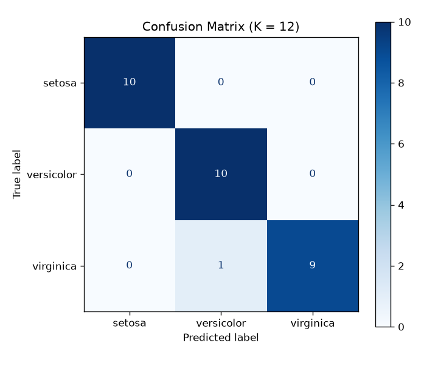
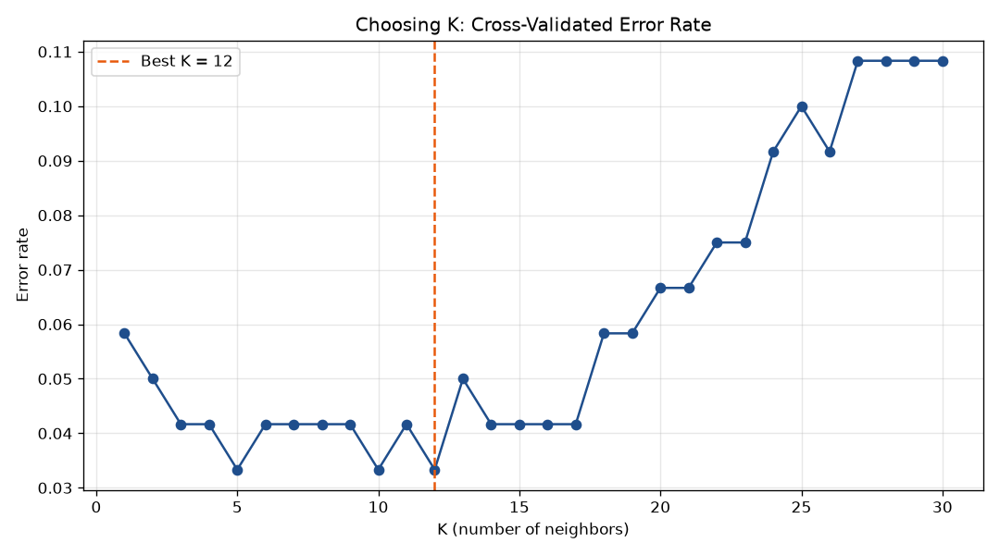

# Iris Flower Classifier (KNN)

**DecodeLabs AI Internship, Project 2: Data Classification Using AI**

A supervised-learning pipeline that classifies iris flowers into three species (setosa, versicolor, virginica) from four measurements, using K-Nearest Neighbors. It covers the full workflow: load, explore, split, scale, train, tune, evaluate, and predict.

## Results

| Metric | Value |
|---|---|
| Final model | KNN, K = 12 |
| Test accuracy | 96.67% (29 of 30 correct) |
| Macro F1 | 0.97 |



|  | Precision | Recall | F1 |
|---|---|---|---|
| setosa | 1.00 | 1.00 | 1.00 |
| versicolor | 0.91 | 1.00 | 0.95 |
| virginica | 1.00 | 0.90 | 0.95 |

The only mistake was one virginica flower predicted as versicolor. These two species overlap in the data, as the pairplot shows.

## Algorithm comparison

All models use the same split and the same scaling.

| Algorithm | CV accuracy (train) | Test accuracy | Test macro F1 |
|---|---|---|---|
| KNN (K=12) | 0.9667 | 0.9667 | 0.9666 |
| Logistic Regression | 0.9583 | 0.9333 | 0.9333 |
| Decision Tree | 0.9417 | 0.9333 | 0.9333 |
| SVM | 0.9667 | 0.9667 | 0.9666 |

## Pipeline

1. **Load and explore:** 150 samples, 4 features, 3 balanced classes (50 each), no missing values.
2. **Split:** shuffled 80/20 train/test split, stratified so each class is balanced in both sets.
3. **Scale:** `StandardScaler` fitted on the training data only, then applied to the test data (no data leakage).
4. **Train:** `KNeighborsClassifier` with `fit()` and `predict()`.
5. **Tune K:** 5-fold cross-validation on the training set for K = 1 to 30. The test set was not used to choose K.
6. **Evaluate:** confusion matrix, precision, recall and F1.
7. **Predict:** classify new flowers from the command line.



## Honest notes

- The test set has only 30 flowers, so **one flower equals 3.3%**. Differences between algorithms of one or two flowers are within noise.
- K = 5, 10 and 12 tied for the lowest cross-validated error. K = 12 was chosen by a tie-break rule (largest K among ties). The model is stable across a range of K values.
- Iris is a small, easy benchmark dataset. These results show a correct pipeline, not real-world difficulty.

## How to run

```
python -m venv venv
venv\Scripts\activate
pip install -r requirements.txt

python -m src.explore      # explore the data
python -m src.preprocess   # split and scale
python -m src.train        # train KNN (K=5)
python -m src.tune         # find the best K
python -m src.evaluate     # confusion matrix, precision, recall, F1
python -m src.compare      # compare algorithms
python -m src.predict 5.9 3.0 5.1 1.8   # predict a new flower (cm)

python -m unittest discover -s tests -v   # run the tests
```

## Project structure

```
iris-classifier/
├── src/
│   ├── data_loader.py   # load Iris
│   ├── explore.py       # data exploration and pairplot
│   ├── preprocess.py    # shuffle, split, scale
│   ├── train.py         # train KNN
│   ├── tune.py          # choose K with cross-validation
│   ├── evaluate.py      # metrics and confusion matrix
│   ├── compare.py       # algorithm comparison
│   └── predict.py       # predict new flowers
├── tests/               # unit tests
├── outputs/             # plots, report, saved model
└── requirements.txt
```

## Built with

Python, scikit-learn, pandas, matplotlib, seaborn

## Author

Maham Shaukat | [GitHub](https://github.com/MahamHayatDev)